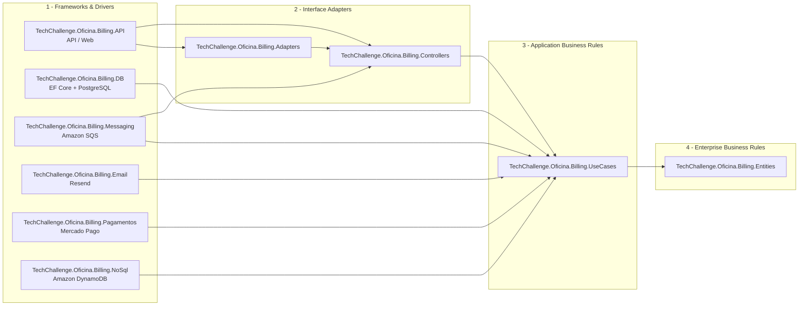
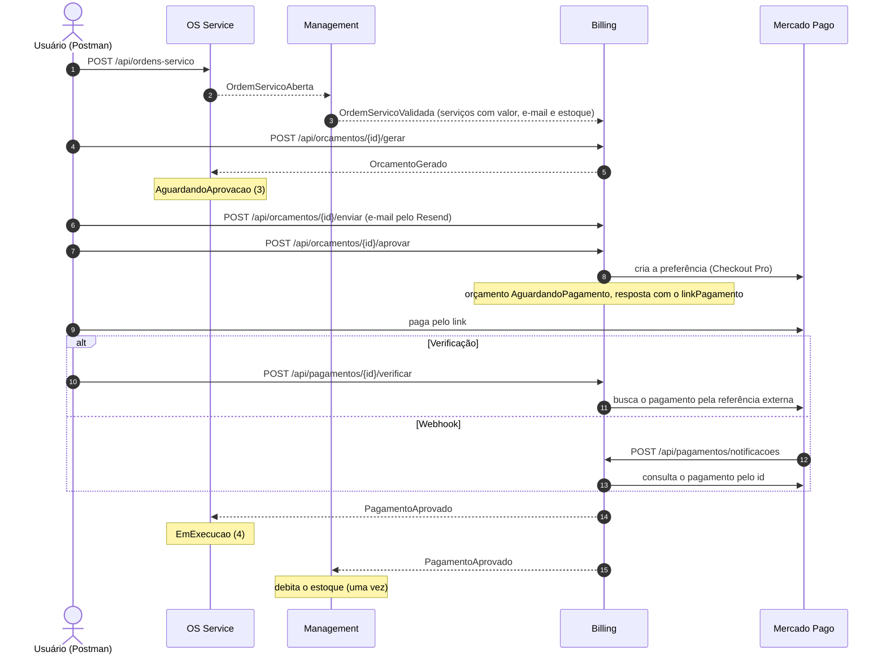
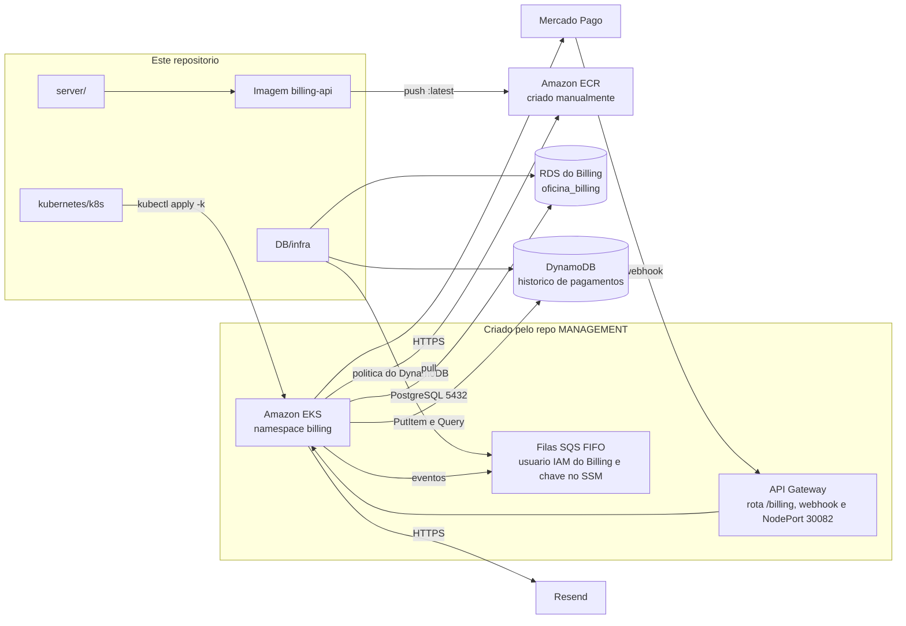

# Projeto Oficina — Billing

## 1. Identificação

Microsserviço de orçamento e pagamentos do software de gestão de uma oficina mecânica.

Tech Challenge da Fase 4 do curso SOAT16 da FIAP. Na fase 4, o orçamento saiu do serviço Management e, junto com o pagamento pelo Mercado Pago, virou este microsserviço, com banco, namespace no Kubernetes e pipelines próprios ([ADR-021](./docs/adr/ADR-021-Billing-Service-Orcamento-e-Pagamentos-com-Banco-Proprio.md) e [ADR-022](./docs/adr/ADR-022-Pagamentos-com-Mercado-Pago.md)).

O sistema tem cinco repositórios:
- **BILLING** (este): orçamento (gerar, consultar, enviar por e-mail, aprovar e recusar), pagamentos pelo Mercado Pago e, por evento, a liberação da OS para execução depois do pagamento.
- [OS-SERVICE](https://github.com/GuiToniello/tech-challenge-fase-4-OS-SERVICE-soat16-rm374658): ciclo de vida da OS (abertura, atualização, status, histórico, acompanhamento e indicadores).
- [MANAGEMENT](https://github.com/GuiToniello/tech-challenge-fase-4-MANAGEMENT-soat16-rm374658): cadastros (clientes, veículos, serviços e insumos), estoque, validação da OS e e-mail de mudança de status. Também cria a rede, o cluster EKS, o API Gateway, o Datadog e as filas SQS que este repositório usa.
- [EXECUTION](https://github.com/GuiToniello/tech-challenge-fase-4-EXECUTION-AND-PRODUCTION-soat16-rm374658): Execução e Produção, com banco próprio: a fila de produção da oficina, o diagnóstico e a execução da OS. Não troca eventos com este serviço: o Billing não publica na fila dele, e ele só publica para o OS Service.
- [LAMBDA](https://github.com/GuiToniello/tech-challenge-fase-4-LAMBDA-soat16-rm374658): autenticação (Lambda authorizer e `POST /auth/token`).

Os serviços se comunicam só por eventos no Amazon SQS ([ADR-020](https://github.com/GuiToniello/tech-challenge-fase-4-MANAGEMENT-soat16-rm374658/blob/main/docs/adr/ADR-020-Eventos-com-SQS-e-Saga-Coreografada.md)): não há chamadas HTTP entre as APIs, e nenhum serviço lê o banco do outro. Além do SQS e do Amazon DynamoDB (histórico de pagamentos, [ADR-024](./docs/adr/ADR-024-Historico-de-Pagamentos-no-DynamoDB.md)), este serviço só chama serviços externos: o Mercado Pago (pagamentos) e o Resend (e-mail).

Grupo:
-  Guilherme Toniello Vieira -  SOAT16 - rm374658

### 1.1 Estrutura do repositório

```
/
├── server/               Solução .NET: Billing, camadas da Clean Architecture e testes
├── e2e/                  Collection do Postman (orçamentos e pagamentos) e environment da AWS
├── docker-compose.yml    Postgres + ElasticMQ (SQS local) + DynamoDB Local + Billing para rodar localmente
├── elasticmq.conf        Filas FIFO do ElasticMQ, as mesmas do SQS na AWS
├── DB/infra/             Terraform do Amazon RDS PostgreSQL e da tabela DynamoDB do Billing
├── kubernetes/k8s/       Manifests Kubernetes do Billing (Kustomize)
├── docs/                 ADR-021, ADR-022, ADR-024 e observabilidade
└── .github/workflows/    Pipelines (build, testes, imagem, Terraform do banco e deploy no cluster)
```

| Pasta | O que tem | Documentação |
|---|---|---|
| [server/](./server/) | Código .NET 10 da `TechChallenge.Oficina.Billing.API` e testes | Seções 2 a 5 deste README |
| [e2e/](./e2e/) | Collection do Postman e environment da AWS | Seção 8 |
| [DB/infra/](./DB/infra/) | Amazon RDS PostgreSQL, tabela DynamoDB do histórico de pagamentos e a política IAM dela (state `techchallenge-oficina/fase-4/billing-database.tfstate`) | Seção 6 |
| [kubernetes/k8s/](./kubernetes/k8s/) | Namespace, ConfigMap, Secret, Deployment, Service e HPA do `billing-api` | Seção 6 |
| [docs/](./docs/) | [ADR-021](./docs/adr/ADR-021-Billing-Service-Orcamento-e-Pagamentos-com-Banco-Proprio.md), [ADR-022](./docs/adr/ADR-022-Pagamentos-com-Mercado-Pago.md), [ADR-024](./docs/adr/ADR-024-Historico-de-Pagamentos-no-DynamoDB.md) e o [contrato de observabilidade](./docs/observabilidade.md) deste serviço | Seção 9 |
| [.github/workflows/](./.github/workflows/) | Bootstrap, Deploy, Destroy e K8s Apply | [.github/workflows/README.md](./.github/workflows/README.md) |

## 2. Arquitetura

A visão geral do sistema (diagrama de componentes e diagramas de sequência) está no [docs/arquitetura.md do MANAGEMENT](https://github.com/GuiToniello/tech-challenge-fase-4-MANAGEMENT-soat16-rm374658/blob/main/docs/arquitetura.md).

O código segue a mesma Clean Architecture da Management ([ADR-001](https://github.com/GuiToniello/tech-challenge-fase-4-MANAGEMENT-soat16-rm374658/blob/main/docs/adr/ADR-001-Clean-Architecture.md)), com 4 anéis e as dependências sempre apontando para dentro:



Os padrões são os mesmos da Management: folder-by-feature, Gateways, Commands/Queries/ViewModels (CQS), AutoMapper nos UseCases, EF Core com PostgreSQL e migrations no startup, Swagger, erros em duas camadas e logs JSON com Serilog. As integrações seguem o padrão do e-mail da Management ([ADR-011](https://github.com/GuiToniello/tech-challenge-fase-4-MANAGEMENT-soat16-rm374658/blob/main/docs/adr/ADR-011-Envio-de-Email-de-Orcamento.md)): os casos de uso dependem só de portas, implementadas no anel de fora.

| Porta (UseCases) | Implementação | Para quê |
|---|---|---|
| `IOrcamentoEmailSender` | Projeto `Email` (`OrcamentoEmailSender`, SDK do Resend) | Enviar o orçamento por e-mail |
| `IGatewayPagamento` | Projeto `Pagamentos` (`GatewayPagamentoMercadoPago` ou `GatewayPagamentoSimulado`), o único com o SDK do Mercado Pago | Criar a cobrança e consultar o pagamento ([ADR-022](./docs/adr/ADR-022-Pagamentos-com-Mercado-Pago.md)) |
| `IEventosPublisher` | Projeto `Messaging` (`EventosPublisher`, SDK do SQS) | Publicar os eventos nas filas dos outros serviços |
| `IHistoricoPagamentoGateway` | Projeto `NoSql` (`HistoricoPagamentoGateway`, SDK do DynamoDB) | Gravar (*best-effort*) e consultar o histórico de pagamentos ([ADR-024](./docs/adr/ADR-024-Historico-de-Pagamentos-no-DynamoDB.md)) |

O evento consumido entra pelo [EventosController](./server/2%20-%20Interface%20Adapters/TechChallenge.Oficina.Billing.Controllers/Features/Eventos/EventosController.cs), como uma requisição HTTP entra por um endpoint.

### 2.1 Responsabilidades

| Fica neste serviço | Fica em outro serviço |
|---|---|
| Orçamento: gerar (e gerar de novo), consultar, enviar por e-mail, aprovar e recusar | Clientes, veículos, serviços, insumos, preços e estoque (Management) |
| Cobrança no Mercado Pago (Checkout Pro), verificação do pagamento e webhook | Validação da OS e débito de estoque depois do pagamento (Management) |
| Snapshot da OS: dados validados pela Management e status vindo do OS Service | Ciclo de vida, status, histórico e indicadores da OS (OS Service) |
| Registro das cobranças, mantido mesmo se a OS for excluída | E-mail de mudança de status (Management) |
| Histórico dos eventos de pagamento no DynamoDB, complementar ao registro das cobranças | Fila de produção, diagnóstico e execução da OS (Execução e Produção) |

O Billing não guarda cadastros. Os serviços da OS, com nome e valor, o e-mail do cliente e a informação de estoque chegam prontos no evento `OrdemServicoValidada`, calculados pela Management.

### 2.2 Rotas

As rotas ficam na raiz da API. Na AWS, ganham o prefixo `/billing` do API Gateway. Localmente, o Swagger fica em `http://localhost:7196/index.html`.

| Rota | Resposta | Regras |
|---|---|---|
| `GET /api/orcamentos/{ordemServicoId}` | 200 com o orçamento, ou 404 | — |
| `POST /api/orcamentos/{ordemServicoId}/gerar` | 200 com o orçamento | OS conhecida (senão 404), já validada pela Management e com estoque suficiente (senão 400), em `Recebida`, `EmDiagnostico` ou `AguardandoAprovacao`. Pode ser gerado de novo enquanto `Gerado`. Publica `OrcamentoGerado` |
| `POST /api/orcamentos/{ordemServicoId}/enviar` | 204 | E-mail pelo Resend para o e-mail do cliente; com cobrança pendente, leva o link de pagamento. 400 sem a chave do Resend ou sem o e-mail do cliente |
| `POST /api/orcamentos/{ordemServicoId}/aprovar` | 200 com `{orcamento, pagamento}` | Orçamento `Gerado` (ou `AguardandoPagamento`) e OS em `Recebida`, `EmDiagnostico` ou `AguardandoAprovacao`. Cria a cobrança, e o orçamento vai para `AguardandoPagamento`; o link fica em `pagamento.linkPagamento`. Com cobrança pendente, devolve a mesma; depois de um pagamento recusado, cria outra |
| `POST /api/orcamentos/{ordemServicoId}/recusar` | 200 com o orçamento | Orçamento `Gerado` ou `AguardandoPagamento` e OS em `Recebida`, `EmDiagnostico` ou `AguardandoAprovacao`. Publica `OrcamentoRecusado` |
| `GET /api/pagamentos/{ordemServicoId}` | 200 com a cobrança mais recente, ou 404 | — |
| `POST /api/pagamentos/{ordemServicoId}/verificar` | 200 com a cobrança | 404 sem cobrança. Já aprovada: responde sem consultar. Senão, consulta o Mercado Pago; se aprovado, confirma o orçamento e publica `PagamentoAprovado` (uma vez) |
| `GET /api/pagamentos/{ordemServicoId}/historico` | 200 com a lista de eventos (vazia se não houver) | Histórico no DynamoDB, em ordem cronológica: `CobrancaCriada` (aprovação), `NotificacaoRecebida` (webhook) e o resultado de cada verificação ou notificação (`PagamentoPendente`, `PagamentoAprovado` ou `PagamentoRecusado`). Os itens expiram em 180 dias. Falha no DynamoDB: 500 ([ADR-024](./docs/adr/ADR-024-Historico-de-Pagamentos-no-DynamoDB.md)) |
| `POST /api/pagamentos/notificacoes` | Sempre 200 | Webhook do Mercado Pago, anônimo. Só trata notificações de `payment` e consulta o pagamento no Mercado Pago pelo id |
| `GET /health` e `GET /health/ready` | 200 (o ready responde 503 sem banco) | Anônimos; só o ready verifica o banco |

- Status do orçamento: `Gerado` 1, `AguardandoPagamento` 2, `Aprovado` 3 (pagamento confirmado) e `Recusado` 4. Status do pagamento: `Pendente` 1, `Aprovado` 2 e `Recusado` 3, com `provedor` = `MercadoPago` ou `Simulado`.
- Erros esperados respondem 400 (regra de negócio) ou 404 (não encontrado), com `{"message": "..."}`; os inesperados respondem 500, pelo middleware global ([ADR-013](https://github.com/GuiToniello/tech-challenge-fase-4-MANAGEMENT-soat16-rm374658/blob/main/docs/adr/ADR-013-Estrategia-de-Tratamento-de-Erros-em-Duas-Camadas.md)).

### 2.3 Eventos

Envelope JSON (camelCase): `{"id","tipo","versao":1,"ocorridoEm","origem","dados"}`, com `origem` = `billing` nos eventos publicados aqui. As filas são FIFO, com `MessageGroupId` = id da OS (ordem garantida por OS), `MessageDeduplicationId` = id do envelope e o atributo de mensagem `tipo`. Os contratos ficam em [Features/Eventos/Contratos](./server/3%20-%20Application%20Business%20Rules/TechChallenge.Oficina.Billing.UseCases/Features/Eventos/Contratos/), uma cópia dos contratos dos outros serviços.

| Evento | Direção | Quando | Dados → efeito |
|---|---|---|---|
| `OrdemServicoValidada` | Consumido (← Management) | OS aberta ou atualizada, com os cadastros válidos | `ordemServicoId`, `clienteId`, `veiculoId`, `clienteEmail`, `estoqueSuficiente`, `servicos` (`servicoId`, `nome`, `valor`) e `valorTotal` → grava ou atualiza o snapshot, mantendo o status já conhecido |
| `OrdemServicoStatusAlterado` | Consumido (← OS Service) | Cada mudança de status | `ordemServicoId`, `clienteId`, `statusAnterior`, `statusNovo` → atualiza o status. Se a OS ainda não é conhecida, cria uma referência parcial, sem serviços |
| `OrdemServicoExcluida` | Consumido (← OS Service) | OS excluída | `ordemServicoId` → apaga a referência e o orçamento; os pagamentos ficam |
| `OrdemServicoRejeitada` | Consumido (← Management) | Algum cadastro da OS não existe | `ordemServicoId`, `motivo` → apaga a referência |
| `OrcamentoGerado` | Publicado (→ OS Service e Management) | Orçamento gerado (ou gerado de novo) | `ordemServicoId`, `valorTotal` → OS `AguardandoAprovacao` (3), com o valor |
| `OrcamentoRecusado` | Publicado (→ OS Service e Management) | Orçamento recusado | `ordemServicoId` → OS `Finalizada` (5) |
| `PagamentoAprovado` | Publicado (→ OS Service e Management) | Pagamento confirmado, uma única vez | `ordemServicoId`, `pagamentoId`, `valor` → OS `EmExecucao` (4), e a Management debita o estoque (uma vez por OS) |

- **Fila consumida:** `techchallenge-oficina-billing.fifo`. **Filas de publicação:** `techchallenge-oficina-os-service.fifo` e `techchallenge-oficina-management.fifo` (lista `SqsSettings:FilasPublicacao`).
- ***Fan-out* no publicador:** o mesmo envelope (com o mesmo `id`) vai para as duas filas, com um log `evento.publicado` por fila. Quem não usa o evento o ignora: a Management, por exemplo, ignora `OrcamentoGerado`. Pela regra da ADR-020 (cada serviço publica nas filas de quem consome algum evento dele), o Billing não publica na fila do Execução e Produção, que não usa nenhum evento daqui.
- **Publicar depois de gravar:** se a publicação falhar numa fila, sai `integracao.falha` (com a `Fila`) e a requisição responde 500. A alteração já gravada continua, e as filas anteriores já receberam o evento.
- **Consumo idempotente:** status repetido, OS desconhecida e tipos que este serviço não trata (como `OrdemServicoAberta` e `OrdemServicoAtualizada`, que também chegam aqui) são ignorados, e a mensagem é apagada. Dados inválidos lançam exceção: a mensagem volta depois do *visibility timeout* e, no 5º recebimento, vai para a DLQ. O lote é processado em sequência e para na primeira falha, para um evento da mesma OS não passar na frente.
- `OrcamentoAprovado` não existe mais: aprovar o orçamento só leva a OS para execução depois do pagamento ([ADR-021](./docs/adr/ADR-021-Billing-Service-Orcamento-e-Pagamentos-com-Banco-Proprio.md)).
- Status nos eventos: `Recebida` 1, `EmDiagnostico` 2, `AguardandoAprovacao` 3, `EmExecucao` 4, `Finalizada` 5, `Entregue` 6, `Encerrada` 7 (sem uso) e `Cancelada` 8.

### 2.4 Saga



- Setas tracejadas são eventos no SQS. Cada mudança de status no OS Service também publica `OrdemServicoStatusAlterado`, que atualiza o status no snapshot do Billing (fora do diagrama).
- **Diagnóstico e execução (fora do diagrama):** antes do orçamento, o diagnóstico pode começar no Execução e Produção (`DiagnosticoIniciado` → OS `EmDiagnostico`); depois do pagamento, a OS entra na fila de produção dele, que finaliza a execução (`ExecucaoFinalizada` → OS `Finalizada`). Esses eventos vão só para o OS Service; o Billing só vê o status novo, pelo `OrdemServicoStatusAlterado`.
- **Recusa:** `POST /api/orcamentos/{id}/recusar` → `OrcamentoRecusado` → OS `Finalizada` (5).
- **Compensação:** se algum cadastro não existir, a Management publica `OrdemServicoRejeitada`: o OS Service cancela a OS (`Cancelada`, 8), e o Billing apaga a referência.

### 2.5 Autenticação

Igual à Management e ao OS Service: os endpoints exigem um JWT do Auth0 (`Authorization: Bearer <token>`), exceto `/health`, `/health/ready` e o webhook `POST /api/pagamentos/notificacoes`. O webhook é anônimo porque o Mercado Pago não envia o JWT; a situação do pagamento é sempre consultada no próprio Mercado Pago ([ADR-022](./docs/adr/ADR-022-Pagamentos-com-Mercado-Pago.md)). O `AuthSettings` do `appsettings.json` usa o mesmo `Authority` e o mesmo `Audience` das outras APIs, então o mesmo token vale para as quatro. Na AWS, o Lambda authorizer do API Gateway exige também a claim `cpf` nas rotas `/billing/...` ([RFC-003](https://github.com/GuiToniello/tech-challenge-fase-4-LAMBDA-soat16-rm374658/blob/main/docs/rfc/RFC-003-Estrategia-de-Autenticacao.md)); a rota do webhook é pública no gateway.

## 3. Pagamentos com o Mercado Pago

O Billing cobra pelo Checkout Pro: ao aprovar o orçamento, cria uma preferência com o valor total, com o id da OS na referência externa (`external_reference`), e devolve o link de pagamento (`init_point`). A confirmação é sempre consultada no Mercado Pago, pela verificação ou pelo webhook. As decisões estão na [ADR-022](./docs/adr/ADR-022-Pagamentos-com-Mercado-Pago.md).

### 3.1 Modo simulado (padrão)

Sem `MercadoPagoSettings:AccessToken`, o Billing usa o `GatewayPagamentoSimulado`, sem conta e sem chamar o Mercado Pago:
- `aprovar` devolve o link fictício `https://simulado.mercadopago.local/checkout/{ordemServicoId}`, com `provedor` = `Simulado`;
- `verificar` aprova o pagamento na hora (`pagamentoExternoId` = `SIM-PAY-` mais o id da OS sem hífens) e publica `PagamentoAprovado`;
- cada operação gera o log `pagamento.simulado` (Warning).

É o modo do `docker compose`, dos testes de integração e da AWS sem o secret `MERCADOPAGO_ACCESS_TOKEN`.

### 3.2 Modo real

Basta configurar o access token:
- **Localmente:** `MERCADOPAGO_ACCESS_TOKEN` no `.env` e `docker compose up -d`, que recria a API. Sem URL pública, deixe `MERCADOPAGO_NOTIFICATION_URL` vazia e confirme o pagamento pela verificação.
- **Na AWS:** secret `MERCADOPAGO_ACCESS_TOKEN` no GitHub e o workflow **K8s Apply**. O `_k8s-apply.yml` grava `MercadoPagoSettings__AccessToken` no Secret `billing-api-secrets` e monta `MercadoPagoSettings__NotificationUrl` com o endpoint do API Gateway: `https://<api-id>.execute-api.us-east-1.amazonaws.com/billing/api/pagamentos/notificacoes`, a rota pública criada pelo MANAGEMENT.

### 3.3 Teste com as credenciais de teste

1. Copie o Access Token das credenciais de teste da sua aplicação no Mercado Pago Developers (começa com `APP_USR-`). Coloque-o no secret `MERCADOPAGO_ACCESS_TOKEN` e rode o K8s Apply (ou, localmente, no `.env`).
2. Gere e aprove o orçamento: a resposta traz `pagamento.linkPagamento`, com `provedor` = `MercadoPago`.
3. Abra o link e pague com o cartão de teste Mastercard `5480 8328 0103 3311`, CVV `123`, validade `11/30` e CPF `12345678909`. O nome do titular define o resultado: `APRO` (aprovado), `OTHE` (recusado) ou `CONT` (pendente).
4. Chame `POST /api/pagamentos/{ordemServicoId}/verificar`. Pagamentos feitos com credenciais de teste podem não disparar o webhook; por isso a verificação consulta o Mercado Pago pela referência externa.
5. **Aprovado:** o orçamento fica `Aprovado`, e a OS vai para `EmExecucao` no OS Service. **Recusado:** o pagamento fica `Recusado`, e o orçamento continua `AguardandoPagamento`; dá para tentar de novo no mesmo link ou aprovar de novo, o que cria outra cobrança.

Detalhes oficiais: [documentação do Checkout Pro](https://www.mercadopago.com.br/developers/pt/docs/checkout-pro/landing).

## 4. Executando localmente

### 4.1 Pré-requisitos

- Para rodar sem container: .NET SDK 10.x e um PostgreSQL.
- Para containers: Docker ou Podman. O `docker-compose.yml` já traz o Postgres, o ElasticMQ, o DynamoDB Local e a API.

Portas usadas, diferentes das da Management (7194), do OS Service (7195) e do Execução e Produção (7197), para os quatro serviços rodarem juntos:

| Serviço | Porta no host |
|---|---|
| Postgres (`oficina-billing-postgres`) | `5434` |
| ElasticMQ (`oficina-billing-elasticmq`) | `9326` |
| DynamoDB Local (`oficina-billing-dynamodb`) | `8000` |
| Billing (`oficina-billing-api`) | `7196` |

Para mudar as portas ou ligar o Mercado Pago e o Resend, crie o `.env` a partir do exemplo (`Copy-Item .env.example .env` no PowerShell, `cp .env.example .env` no Linux/macOS) e ajuste `POSTGRES_PORT`, `ELASTICMQ_PORT`, `DYNAMODB_PORT`, `API_BILLING_PORT`, `DATABASE_CONNECTION_STRING` e, opcionais, `MERCADOPAGO_ACCESS_TOKEN`, `MERCADOPAGO_NOTIFICATION_URL` e `RESEND_API_KEY`.

### 4.2 Containers

Na raiz do repositório, rode `docker compose up -d --build` (ou `podman compose up -d --build`). Sobem o `postgres`, o `elasticmq` (com as seis filas FIFO do `elasticmq.conf`: as três que o Billing usa, a dele e as do OS Service e da Management, e as DLQs), o `dynamodb-local` (em memória; a API cria a tabela do histórico de pagamentos ao subir) e o `billing-api`. O Swagger fica em `http://localhost:7196/index.html`.

Sem `MERCADOPAGO_ACCESS_TOKEN`, o pagamento roda no modo simulado (seção 3.1). Sem `RESEND_API_KEY`, o envio do orçamento por e-mail responde 400.

### 4.3 `dotnet run`

1. Suba o banco, o SQS local e o DynamoDB Local: `docker compose up -d postgres elasticmq dynamodb-local`.
2. Na pasta `server/1 - Frameworks & Drivers/TechChallenge.Oficina.Billing.API/`, rode `dotnet run`.

A API sobe em `http://localhost:7196` (perfil `http` do `launchSettings.json`, ambiente `Development`). O `appsettings.Development.json` aponta o SQS para o ElasticMQ deste repositório (`http://localhost:9326`) e o DynamoDB para o DynamoDB Local (`http://localhost:8000`), e o perfil define credenciais AWS fictícias (`local`), que os dois aceitam. Também dá para abrir o `server/TechChallenge.Oficina.Billing.slnx` no Visual Studio e rodar o perfil `http`.

### 4.4 Saga local com a Management e o OS Service

Sozinho, este serviço não conhece nenhuma OS: o snapshot vem do `OrdemServicoValidada` da Management, e o status, do OS Service. Para ver a saga funcionando, a Management, o OS Service e o Billing precisam usar o mesmo ElasticMQ, o da Management (container `oficina-elasticmq`), que tem as filas de todos os serviços:

1. No repositório [MANAGEMENT](https://github.com/GuiToniello/tech-challenge-fase-4-MANAGEMENT-soat16-rm374658): `podman compose up -d` (ou `docker compose up -d`).
2. No repositório [OS-SERVICE](https://github.com/GuiToniello/tech-challenge-fase-4-OS-SERVICE-soat16-rm374658): `SQS_SERVICE_URL=http://oficina-elasticmq:9324 podman compose up -d --build` e `podman network connect tech-challenge-fase-4-management-soat16-rm374658_default oficina-os-service-api`.
3. Neste repositório, suba o compose apontando o SQS para o ElasticMQ da Management:
   - bash: `SQS_SERVICE_URL=http://oficina-elasticmq:9324 podman compose up -d --build`
   - PowerShell: `$env:SQS_SERVICE_URL="http://oficina-elasticmq:9324"; podman compose up -d --build`
4. Ligue o container do Billing à rede do compose da Management, para ele achar o ElasticMQ pelo nome do container:
   - `podman network connect tech-challenge-fase-4-management-soat16-rm374658_default oficina-billing-api` (no Docker, `docker network connect ...` com os mesmos argumentos).
   - O nome da rede vem do nome da pasta do repositório MANAGEMENT (o nome do projeto do compose, em minúsculas) mais `_default`. Se a pasta tiver outro nome, confira com `podman network ls`.
5. Só para a saga completa (pasta **Saga** da collection do OS-SERVICE), suba também o [EXECUTION](https://github.com/GuiToniello/tech-challenge-fase-4-EXECUTION-AND-PRODUCTION-soat16-rm374658) do mesmo jeito: `SQS_SERVICE_URL=http://oficina-elasticmq:9324 podman compose up -d --build` e `podman network connect tech-challenge-fase-4-management-soat16-rm374658_default oficina-execution-api`. A collection deste repositório não precisa dele.

A Management fica em `http://localhost:7194`, o OS Service em `http://localhost:7195`, o Billing em `http://localhost:7196` e o Execução e Produção em `http://localhost:7197`. Para testar, use a collection deste repositório (seção 8) ou a pasta **Saga** da collection do OS-SERVICE. O ElasticMQ deste repositório continua de pé, mas sem uso.

### 4.5 Testes

```powershell
dotnet test ./server/TechChallenge.Oficina.Billing.slnx
```

Os testes (395) ficam em `server/Tests/`, um projeto por projeto da solução: Entities, UseCases, Controllers, Adapters, DB, Email, Messaging, NoSql, Pagamentos, API e Integration. Eles usam banco em memória e mocks (inclusive do SQS, do Resend e do SDK do DynamoDB). O SDK do Mercado Pago roda contra um `HttpMessageHandler` falso, e os testes de integração usam o gateway simulado e um histórico de pagamentos em memória: não precisam de Postgres, ElasticMQ, DynamoDB, Docker nem conta no Mercado Pago.

### 4.6 Problemas comuns

1. **Erro 401:** confira o token. Ele vem do mesmo Auth0 da Management (seção 2.5).
2. **`gerar` responde 404 ("Ordem de servico nao encontrada") ou 400 ("ainda nao foi validada pela Management"):** o `OrdemServicoValidada` ainda não chegou, ou os serviços não estão usando o mesmo ElasticMQ (seção 4.4). Aguarde alguns segundos.
3. **`gerar` responde 400 ("Estoque insuficiente"):** a Management informou falta de estoque na validação. Aumente o estoque do insumo na Management e atualize a OS no OS Service (só com a OS `Recebida`), para ela ser validada de novo.
4. **`verificar` continua `Pendente` (status 1) no modo real:** o cliente ainda não pagou pelo link, ou o pagamento está em análise. Pague e verifique de novo.
5. **A OS não vai para `EmExecucao` depois do pagamento:** o `PagamentoAprovado` não chegou ao OS Service (mesmo ElasticMQ, seção 4.4), ou o orçamento não estava `AguardandoPagamento` (log "PagamentoAprovado nao publicado").
6. **Logs `integracao.falha` com `Integracao` = `sqs` a cada poucos segundos:** o ElasticMQ configurado em `SQS_SERVICE_URL` (ou em `SqsSettings:ServiceUrl`) não está acessível. Na saga local, confira o passo 4 da seção 4.4.
7. **Logs `integracao.falha` com `Integracao` = `dynamodb` (Warning) ou histórico vazio:** o pagamento segue normalmente, só o histórico fica sem a linha. Localmente, confira se o `dynamodb-local` está no ar (com `dotnet run`, seção 4.3). Na AWS, confira se a política `dynamodb-historico-pagamentos` está no usuário IAM do Billing; se o MANAGEMENT recriou o usuário, rode o Bootstrap deste repositório (seção 7).

## 5. Requisitos atendidos

| Requisito | Atende? | Observação de escopo | Rota | Evidências |
|---|---|---|---|---|
| Geração do orçamento | Sim | Com os serviços e os valores do snapshot validado pela Management; exige estoque suficiente. Publica `OrcamentoGerado` (OS → `AguardandoAprovacao`) | `POST /api/orcamentos/{ordemServicoId}/gerar` e `GET /api/orcamentos/{ordemServicoId}` | [Endpoints](./server/1%20-%20Frameworks%20%26%20Drivers/TechChallenge.Oficina.Billing.API/Features/Orcamentos/OrcamentoEndpoints.cs) · [UseCases](./server/3%20-%20Application%20Business%20Rules/TechChallenge.Oficina.Billing.UseCases/Features/Orcamentos/UseCases/OrcamentoUseCases.cs) · [Entidade](./server/4%20-%20Enterprise%20Business%20Rules/TechChallenge.Oficina.Billing.Entities/Features/Orcamentos/Orcamento.cs) |
| Envio do orçamento ao cliente | Sim | E-mail pelo Resend, com o link de pagamento quando há cobrança pendente | `POST /api/orcamentos/{ordemServicoId}/enviar` | [OrcamentoEmailSender](./server/1%20-%20Frameworks%20%26%20Drivers/TechChallenge.Oficina.Billing.Email/Features/Orcamentos/OrcamentoEmailSender.cs) |
| Aprovação e recusa do orçamento | Sim | Aprovar cria a cobrança e devolve o link de pagamento; recusar publica `OrcamentoRecusado` (OS → `Finalizada`) | `POST /api/orcamentos/{ordemServicoId}/aprovar` e `/recusar` | [UseCases](./server/3%20-%20Application%20Business%20Rules/TechChallenge.Oficina.Billing.UseCases/Features/Orcamentos/UseCases/OrcamentoUseCases.cs) · [Snapshot da OS](./server/4%20-%20Enterprise%20Business%20Rules/TechChallenge.Oficina.Billing.Entities/Features/OrdensServico/OrdemServicoReferencia.cs) |
| Pagamento pelo Mercado Pago | Sim | Checkout Pro. A verificação e o webhook sempre consultam o Mercado Pago; sem access token, modo simulado | `POST /api/pagamentos/{ordemServicoId}/verificar`, `POST /api/pagamentos/notificacoes` e `GET /api/pagamentos/{ordemServicoId}` | [Endpoints](./server/1%20-%20Frameworks%20%26%20Drivers/TechChallenge.Oficina.Billing.API/Features/Pagamentos/PagamentoEndpoints.cs) · [UseCases](./server/3%20-%20Application%20Business%20Rules/TechChallenge.Oficina.Billing.UseCases/Features/Pagamentos/UseCases/PagamentoUseCases.cs) · [Gateway Mercado Pago](./server/1%20-%20Frameworks%20%26%20Drivers/TechChallenge.Oficina.Billing.Pagamentos/Features/Gateways/GatewayPagamentoMercadoPago.cs) · [ADR-022](./docs/adr/ADR-022-Pagamentos-com-Mercado-Pago.md) |
| Histórico de pagamentos em NoSQL | Sim | Amazon DynamoDB, complementar ao PostgreSQL (que continua sendo a fonte da verdade): a aprovação, a verificação e o webhook registram cada evento em *best-effort*, e os itens expiram em 180 dias | `GET /api/pagamentos/{ordemServicoId}/historico` | [Projeto NoSql](./server/1%20-%20Frameworks%20%26%20Drivers/TechChallenge.Oficina.Billing.NoSql/) · [HistoricoPagamentoGateway](./server/1%20-%20Frameworks%20%26%20Drivers/TechChallenge.Oficina.Billing.NoSql/Features/Pagamentos/HistoricoPagamentoGateway.cs) · [dynamodb.tf](./DB/infra/dynamodb.tf) · [ADR-024](./docs/adr/ADR-024-Historico-de-Pagamentos-no-DynamoDB.md) |
| Atualização do status da OS depois do pagamento | Sim | `PagamentoAprovado`, publicado uma única vez: OS → `EmExecucao` no OS Service e débito de estoque na Management | Evento | [UseCases](./server/3%20-%20Application%20Business%20Rules/TechChallenge.Oficina.Billing.UseCases/Features/Pagamentos/UseCases/PagamentoUseCases.cs) · [Entidade Pagamento](./server/4%20-%20Enterprise%20Business%20Rules/TechChallenge.Oficina.Billing.Entities/Features/Pagamentos/Pagamento.cs) |
| Comunicação com os outros serviços (saga) | Sim | Filas SQS FIFO, *fan-out* no publicador, snapshot da OS por eventos, consumo idempotente e DLQ | Filas SQS | [Messaging](./server/1%20-%20Frameworks%20%26%20Drivers/TechChallenge.Oficina.Billing.Messaging/) · [Casos de uso dos eventos](./server/3%20-%20Application%20Business%20Rules/TechChallenge.Oficina.Billing.UseCases/Features/Eventos/UseCases/OrdemServicoEventosUseCases.cs) · [ADR-021](./docs/adr/ADR-021-Billing-Service-Orcamento-e-Pagamentos-com-Banco-Proprio.md) |
| Observabilidade | Sim | Os mesmos mecanismos da Management: logs JSON com eventos de negócio (inclusive `pagamento.*`), APM injetado no cluster, `/health/ready` com o banco, synthetic `GET /billing/health` e o dashboard e os monitores do Datadog, criados no MANAGEMENT. Os monitores de Kubernetes cobrem só o namespace `oficina` | `service` = `billing-api` | [docs/observabilidade.md](./docs/observabilidade.md) · [Eventos de log](./server/3%20-%20Application%20Business%20Rules/TechChallenge.Oficina.Billing.UseCases/Features/OrdensServico/Logging/OrdemServicoLogEventos.cs) · [LoggingExtension](./server/1%20-%20Frameworks%20%26%20Drivers/TechChallenge.Oficina.Billing.API/Extensions/LoggingExtension.cs) |

## 6. Infraestrutura

Este repositório cria só os bancos (o RDS e a tabela DynamoDB do histórico) e os manifests do Billing. O resto vem do MANAGEMENT, que precisa estar de pé antes.

| Parte | Onde | O que é |
|---|---|---|
| Aplicação | [server/](./server/) | Código .NET, testes e imagem Docker, publicada no ECR `techchallenge-oficina-billing` |
| Banco | [DB/infra/](./DB/infra/) | RDS PostgreSQL `techchallenge-oficina-billing-postgres`: banco `oficina_billing`, usuário `sa`, porta `5432`, `db.t3.micro` com 20 GiB `gp3` criptografado, single-AZ, sem backup e sem proteção contra exclusão (ambiente descartável). Subnet group `techchallenge-oficina-billing-rds-subnets` e SG `techchallenge-oficina-billing-rds-sg`, com entrada na `5432` só a partir do SG dos nodes do EKS. As tabelas (`ordens_servico_referencias`, `orcamentos`, `pagamentos` e as de serviços) são criadas pelas migrations da API, no startup |
| Histórico de pagamentos | [DB/infra/](./DB/infra/) | Tabela DynamoDB `techchallenge-oficina-billing-pagamentos-historico` ([dynamodb.tf](./DB/infra/dynamodb.tf)): sob demanda (`PAY_PER_REQUEST`), chave `OrdemServicoId` + `OcorridoEm`, TTL em `ExpiraEm` (180 dias), sem PITR, sem streams e sem proteção contra exclusão. A política inline `dynamodb-historico-pagamentos` ([iam.tf](./DB/infra/iam.tf)), só com `dynamodb:PutItem` e `dynamodb:Query` na tabela, vai para o usuário IAM do Billing criado pelo MANAGEMENT (seção 6.1) |
| Manifests | [kubernetes/k8s/](./kubernetes/k8s/) | Namespace `billing`; ConfigMap `billing-api-config` (ambiente, nível de log, filas SQS, tabela do DynamoDB e `AWS_REGION`); Secret `billing-api-secrets` (connection string, chave do usuário IAM do Billing, que serve ao SQS e ao DynamoDB, token e URL de notificação do Mercado Pago e chave do Resend, gerado pelo pipeline); Deployment `billing-api` (1 réplica inicial, 100m/128Mi de requests, 500m/512Mi de limits, probes em `/health` e labels do Datadog); Service `NodePort` 30082; HPA de 1 a 2 pods (CPU 30% e memória 150%) |

O `DB/infra` encontra a rede do MANAGEMENT pelo cluster EKS e por nome, sem ler o state dele: a VPC vem do cluster, as subnets privadas pela tag `Name = techchallenge-oficina-private-*`, e o SG dos nodes pelo nome.



### 6.1 Contrato com o MANAGEMENT

| Item | Valor | Uso aqui |
|---|---|---|
| Cluster EKS | `techchallenge-oficina-eks` | Variable `EKS_CLUSTER_NAME`; o `DB/infra` lê a VPC do cluster |
| Rede | Subnets `techchallenge-oficina-private-*` e SG `techchallenge-oficina-nodes-sg` | Subnet group e regra de entrada do RDS |
| Rotas e NodePort | `ANY /billing/{proxy+}` (com o authorizer), `GET /billing/health` e `POST /billing/api/pagamentos/notificacoes` (públicas), NodePort `30082` e target group `techchallenge-oficina-billing` | `nodePort: 30082` no [service.yml](./kubernetes/k8s/features/billing-api/service.yml) |
| API Gateway | API `techchallenge-oficina-api`, cujo endpoint muda a cada recriação | O `_k8s-apply.yml` a encontra pelo nome e monta a URL de notificação do Mercado Pago |
| Filas SQS | Consome `techchallenge-oficina-billing.fifo` e publica em `techchallenge-oficina-os-service.fifo` e `techchallenge-oficina-management.fifo` | ConfigMap (`SqsSettings__FilaConsumo`, `SqsSettings__FilasPublicacao__0` e `__1`) |
| Usuário IAM e chave do Billing | Usuário `techchallenge-oficina-billing-sqs` e parâmetros SSM `/techchallenge-oficina/sqs/billing/access-key-id` e `/secret-access-key` | O `_k8s-apply.yml` grava a chave no Secret como `AWS_ACCESS_KEY_ID` e `AWS_SECRET_ACCESS_KEY`; ela serve às filas (política `sqs`, do MANAGEMENT) e à tabela do histórico (política `dynamodb-historico-pagamentos`, que o `DB/infra` daqui anexa ao usuário). Se o MANAGEMENT recriar o usuário, a política some junto: rode o Bootstrap deste repo |
| Datadog | APM no namespace `billing`, `http_check` em `billing-api.billing.svc.cluster.local/health/ready` e synthetic `GET /billing/health` | Labels `tags.datadoghq.com/service: billing-api` e `tags.datadoghq.com/env: study` no Deployment |
| Destroy | O Destroy do MANAGEMENT (job `billing-check`) falha se o RDS `techchallenge-oficina-billing-postgres` ou o SG `techchallenge-oficina-billing-rds-sg` ainda existirem | Rode o Destroy deste repo antes |

Os detalhes do lado do MANAGEMENT estão no [SQS/README.md](https://github.com/GuiToniello/tech-challenge-fase-4-MANAGEMENT-soat16-rm374658/blob/main/SQS/README.md) e no [kubernetes/infra/ESTRUTURA.md](https://github.com/GuiToniello/tech-challenge-fase-4-MANAGEMENT-soat16-rm374658/blob/main/kubernetes/infra/ESTRUTURA.md).

### 6.2 ECR (manual)

Crie uma vez, em `us-east-1`, o repositório privado `techchallenge-oficina-billing`, com *tag mutability* **MUTABLE**: a tag `latest` é sobrescrita a cada push. Ele fica fora de qualquer `destroy`.

## 7. Fluxo de Deploy (CI/CD)

O CI/CD usa GitHub Actions, no mesmo padrão do MANAGEMENT e do OS-SERVICE. Os detalhes estão em [.github/workflows/README.md](./.github/workflows/README.md).

- **Bootstrap** (manual): testes → RDS, tabela DynamoDB e política IAM (`DB/infra`) → build e push da imagem → `kubectl apply` com restart.
- **Deploy**:
  - **Pull Request para a `main`:** build e testes, validação offline do Terraform (`DB/infra`) e do Kustomize, mais o `plan` informativo do banco.
  - **Push na `main`:** aplica só o que mudou, na ordem: `DB/infra` (RDS, tabela DynamoDB e política IAM) → imagem → manifests (com restart).
- **Destroy** (manual, com `confirm=destroy` e aprovação no environment `destroy`): apaga o namespace `billing`, se o cluster existir, e depois o `DB/infra` (RDS, tabela DynamoDB e política IAM).
- **K8s Apply** (manual): reaplica os manifests e reinicia a API. Use depois de trocar `MERCADOPAGO_ACCESS_TOKEN` ou `RESEND_API_KEY`, depois que o MANAGEMENT recriar a chave do usuário IAM do Billing ou o API Gateway (a URL de notificação muda), ou ao ligar e desligar o Datadog. Se o MANAGEMENT recriar o próprio usuário IAM do Billing, use o Bootstrap: a política do DynamoDB precisa ser aplicada de novo no usuário novo.

**Ordem entre os repositórios:**
- **Para subir:** Bootstrap do MANAGEMENT → Bootstrap deste repositório, a qualquer momento (ele não depende do OS-SERVICE nem do EXECUTION, que sobem nesta ordem: OS-SERVICE → EXECUTION) → Deploy do LAMBDA.
- **Para derrubar:** Destroy do LAMBDA, do OS-SERVICE, do EXECUTION e deste repositório (em qualquer ordem) → Destroy do MANAGEMENT.

### 7.1 Configuração no GitHub e na AWS

Feita uma vez, à mão (detalhes no [README das pipelines](./.github/workflows/README.md#secrets-e-variables)). A rede, o EKS, o API Gateway (com a rota do webhook), as filas SQS, o usuário IAM do Billing com a chave no SSM e o Datadog vêm do Bootstrap do MANAGEMENT. O DynamoDB não tem secret nem variable: a tabela vem do `DB/infra`, e a chave é a mesma do SQS.
- **AWS:** o repositório ECR `techchallenge-oficina-billing` (seção 6.2).
- **Secrets:** `AWS_ACCESS_KEY_ID`, `AWS_SECRET_ACCESS_KEY` (o mesmo usuário IAM `terraform` do MANAGEMENT, que também precisa de permissões no DynamoDB e de `iam:PutUserPolicy`; hoje ele é administrador) e `RDS_PASSWORD` (senha do RDS do Billing).
- **Secrets opcionais:** `MERCADOPAGO_ACCESS_TOKEN` (sem ele, modo simulado; seção 3) e `RESEND_API_KEY` (sem ela, o envio do orçamento por e-mail responde 400).
- **Variables:** `AWS_REGION` (`us-east-1`), `ECR_REGISTRY` (`903936907231.dkr.ecr.us-east-1.amazonaws.com`), `EKS_CLUSTER_NAME` (`techchallenge-oficina-eks`), `RDS_INSTANCE_IDENTIFIER` (`techchallenge-oficina-billing-postgres`), `RDS_DATABASE` (`oficina_billing`) e `RDS_USERNAME` (`sa`).
- **Environment `destroy`**, com *Required reviewers* e *Deployment branches* restrito a `main`.
- **Ruleset da `main`**, com Pull Request e os checks obrigatórios `build-test / build-test`, `validate-db / terraform` e `validate-k8s / kubectl`.

**Atenção ao primeiro push na `main`:** todos os arquivos entram como alterados, e o Deploy tenta aplicar tudo, **criando o RDS do Billing (custo)** se os secrets da AWS já estiverem configurados. Se ainda não quiser subir nada, faça o primeiro push antes de configurar os secrets: os applies falham na credencial e não criam nada. Quando quiser subir, configure tudo e rode o Bootstrap, depois do Bootstrap do MANAGEMENT.

## 8. Testes E2E (Postman)

Use a collection `e2e/TechChallenge.Oficina.Billing.API.postman_collection.json`:
- **00 - Setup:** pega o token do Auth0, cadastra o cliente do token na Management, gera o JWT com `cpf` pela Lambda (só na AWS), cria os cadastros base na Management (cliente, veículo, insumo e serviço) e abre duas OS no OS Service, uma para aprovar e outra para recusar. Rode antes das outras pastas.
- **Orcamentos:** gerar, consultar, gerar de novo, enviar por e-mail (204, ou 400 sem o Resend), aprovar (com o link de pagamento), aprovar de novo (mesma cobrança), recusar a segunda OS e os casos de erro (400 e 404).
- **Pagamentos:** consultar a cobrança, verificar (aprovada no modo simulado), verificar de novo, consultar o histórico no DynamoDB (`CobrancaCriada` e, no modo simulado, `PagamentoAprovado`, em ordem cronológica), conferir o orçamento `Aprovado` e a OS `EmExecucao` no OS Service, os 404 de OS sem cobrança, o webhook sem token (200, inclusive com id falso) e a verificação sem token (401).

Os passos com espera aguardam o consumo dos eventos pelas outras APIs (`tempo_espera_ms`, padrão de 3000 ms). A saga completa, até a entrega da OS (com o diagnóstico e a execução no Execução e Produção), está na pasta **Saga** da [collection do OS-SERVICE](https://github.com/GuiToniello/tech-challenge-fase-4-OS-SERVICE-soat16-rm374658/blob/main/e2e/TechChallenge.Oficina.OsService.API.postman_collection.json).

Localmente, a collection usa `baseUrl` = `http://localhost:7196`, `osBaseUrl` = `http://localhost:7195` e `managementBaseUrl` = `http://localhost:7194`, com `tokenUrl` vazio (o JWT com `cpf` não é gerado, e vale o token direto do Auth0). As três APIs (Management, OS Service e Billing) precisam estar no ar, com o mesmo ElasticMQ (seção 4.4).

Na AWS, importe também o `e2e/AWS.postman_environment.json` e preencha só o `gatewayUrl` (a URL do API Gateway, output `api_gateway_endpoint` do MANAGEMENT). O environment monta `baseUrl` = `{{gatewayUrl}}/billing`, `osBaseUrl` = `{{gatewayUrl}}/os`, `managementBaseUrl` = `{{gatewayUrl}}/management` e `tokenUrl` = `{{gatewayUrl}}/auth/token`.

## 9. Decisões de arquitetura (ADRs e RFCs)

As ADRs e RFCs são numeradas em sequência única entre os cinco repositórios. Este repositório guarda:
- [ADR-021: Billing Service, Orçamento e Pagamentos com Banco Próprio](./docs/adr/ADR-021-Billing-Service-Orcamento-e-Pagamentos-com-Banco-Proprio.md)
- [ADR-022: Pagamentos com Mercado Pago](./docs/adr/ADR-022-Pagamentos-com-Mercado-Pago.md)
- [ADR-024: Histórico de Pagamentos no Amazon DynamoDB](./docs/adr/ADR-024-Historico-de-Pagamentos-no-DynamoDB.md)

As demais ficam no MANAGEMENT (índice em [docs/adr/INDICE.md](https://github.com/GuiToniello/tech-challenge-fase-4-MANAGEMENT-soat16-rm374658/blob/main/docs/adr/INDICE.md)), no OS-SERVICE, no EXECUTION e no LAMBDA, e valem também para este serviço:

- Código: [ADR-001 Clean Architecture](https://github.com/GuiToniello/tech-challenge-fase-4-MANAGEMENT-soat16-rm374658/blob/main/docs/adr/ADR-001-Clean-Architecture.md), [ADR-002 DDD e entidades ricas](https://github.com/GuiToniello/tech-challenge-fase-4-MANAGEMENT-soat16-rm374658/blob/main/docs/adr/ADR-002-DDD-e-Entidades-Ricas.md), [ADR-004 Gateways](https://github.com/GuiToniello/tech-challenge-fase-4-MANAGEMENT-soat16-rm374658/blob/main/docs/adr/ADR-004-Gateways-e-Persistencia.md), [ADR-005 Commands/Queries/ViewModels](https://github.com/GuiToniello/tech-challenge-fase-4-MANAGEMENT-soat16-rm374658/blob/main/docs/adr/ADR-005-Separacao-Commands-Queries-ViewModels.md), [ADR-006 AutoMapper](https://github.com/GuiToniello/tech-challenge-fase-4-MANAGEMENT-soat16-rm374658/blob/main/docs/adr/ADR-006-AutoMapper-nos-UseCases.md), [ADR-007 EF Core com PostgreSQL](https://github.com/GuiToniello/tech-challenge-fase-4-MANAGEMENT-soat16-rm374658/blob/main/docs/adr/ADR-007-EFCore-com-PostgreSQL.md), [ADR-008 Swagger](https://github.com/GuiToniello/tech-challenge-fase-4-MANAGEMENT-soat16-rm374658/blob/main/docs/adr/ADR-008-Swagger-para-API.md), [ADR-009 Migrações no startup](https://github.com/GuiToniello/tech-challenge-fase-4-MANAGEMENT-soat16-rm374658/blob/main/docs/adr/ADR-009-Migracoes-Automaticas-no-Startup.md) e [ADR-013 Erros em duas camadas](https://github.com/GuiToniello/tech-challenge-fase-4-MANAGEMENT-soat16-rm374658/blob/main/docs/adr/ADR-013-Estrategia-de-Tratamento-de-Erros-em-Duas-Camadas.md).
- Negócio: [ADR-011 E-mail](https://github.com/GuiToniello/tech-challenge-fase-4-MANAGEMENT-soat16-rm374658/blob/main/docs/adr/ADR-011-Envio-de-Email-de-Orcamento.md) (o padrão de porta e adapter usado aqui no e-mail e no pagamento) e [ADR-012 Estoque](https://github.com/GuiToniello/tech-challenge-fase-4-MANAGEMENT-soat16-rm374658/blob/main/docs/adr/ADR-012-Controle-de-Estoque-de-Insumos.md).
- Plataforma e serviços: [ADR-014 Observabilidade com Datadog](https://github.com/GuiToniello/tech-challenge-fase-4-MANAGEMENT-soat16-rm374658/blob/main/docs/adr/ADR-014-Observabilidade-com-Datadog.md), [ADR-015 Comunicação síncrona via API Gateway](https://github.com/GuiToniello/tech-challenge-fase-4-MANAGEMENT-soat16-rm374658/blob/main/docs/adr/ADR-015-Comunicacao-Sincrona-via-API-Gateway.md), [ADR-016 HPA](https://github.com/GuiToniello/tech-challenge-fase-4-MANAGEMENT-soat16-rm374658/blob/main/docs/adr/ADR-016-Escalabilidade-com-HPA.md), [ADR-017 PostgreSQL no RDS](https://github.com/GuiToniello/tech-challenge-fase-4-MANAGEMENT-soat16-rm374658/blob/main/docs/adr/ADR-017-PostgreSQL-no-Amazon-RDS-e-Modelo-de-Dados.md), [ADR-019 OS Service](https://github.com/GuiToniello/tech-challenge-fase-4-OS-SERVICE-soat16-rm374658/blob/main/docs/adr/ADR-019-OS-Service-Microsservico-com-Banco-Proprio.md) (repo OS-SERVICE), [ADR-023 Execução e Produção](https://github.com/GuiToniello/tech-challenge-fase-4-EXECUTION-AND-PRODUCTION-soat16-rm374658/blob/main/docs/adr/ADR-023-Execucao-e-Producao-Fila-de-Execucao-e-Status-por-Eventos.md) (repo EXECUTION) e [ADR-020 Eventos com SQS e saga coreografada](https://github.com/GuiToniello/tech-challenge-fase-4-MANAGEMENT-soat16-rm374658/blob/main/docs/adr/ADR-020-Eventos-com-SQS-e-Saga-Coreografada.md).
- NoSQL no mesmo padrão da ADR-024, com tabela e política próprias: [ADR-025 Linha do tempo da produção no DynamoDB](https://github.com/GuiToniello/tech-challenge-fase-4-EXECUTION-AND-PRODUCTION-soat16-rm374658/blob/main/docs/adr/ADR-025-Linha-do-Tempo-da-Producao-no-DynamoDB.md) (repo EXECUTION), [ADR-026 Histórico da saga no DynamoDB](https://github.com/GuiToniello/tech-challenge-fase-4-OS-SERVICE-soat16-rm374658/blob/main/docs/adr/ADR-026-Historico-da-Saga-no-DynamoDB.md) (repo OS-SERVICE) e [ADR-027 Histórico de movimentações de estoque no DynamoDB](https://github.com/GuiToniello/tech-challenge-fase-4-MANAGEMENT-soat16-rm374658/blob/main/docs/adr/ADR-027-Historico-de-Movimentacoes-de-Estoque-no-DynamoDB.md) (repo MANAGEMENT).
- RFCs: [RFC-001 Escolha da nuvem](https://github.com/GuiToniello/tech-challenge-fase-4-MANAGEMENT-soat16-rm374658/blob/main/docs/rfc/RFC-001-Escolha-da-Nuvem.md), [RFC-002 Escolha do banco de dados](https://github.com/GuiToniello/tech-challenge-fase-4-MANAGEMENT-soat16-rm374658/blob/main/docs/rfc/RFC-002-Escolha-do-Banco-de-Dados.md), [RFC-003 Estratégia de autenticação](https://github.com/GuiToniello/tech-challenge-fase-4-LAMBDA-soat16-rm374658/blob/main/docs/rfc/RFC-003-Estrategia-de-Autenticacao.md) (repo LAMBDA) e [RFC-004 Comunicação entre microsserviços](https://github.com/GuiToniello/tech-challenge-fase-4-MANAGEMENT-soat16-rm374658/blob/main/docs/rfc/RFC-004-Comunicacao-entre-Microsservicos.md).
